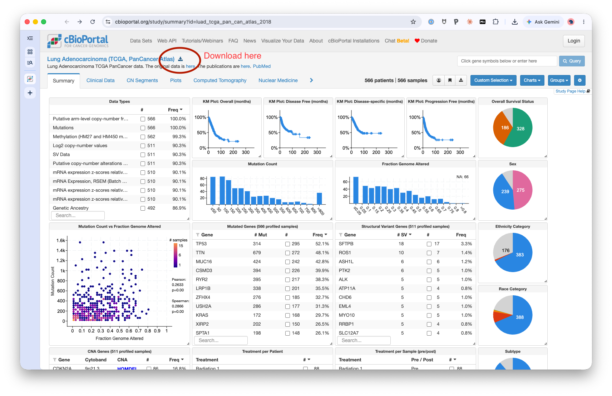

# Lab 4: Database-Driven Feature Table

**Assigned:** Mon, Oct 19 (Week 9). **Due:** Wed, Oct 28, 11:59pm (see [SCHEDULE.md](../../SCHEDULE.md)). **Weight:** 9% of final grade.

This lab uses the SQL from [Week 8](../../lectures/week08-relational-databases/README.md) (joins, grain, `LEFT JOIN`, missing data). Bring questions to the Wed, Oct 21 practical, which includes Lab 4 work time.

## Background

Real analyses rarely start from one flat file. They start from a
relational database that has to be queried and joined into an analysis-
ready table. This lab builds that skill on real tumor sequencing data,
using the three habits from Week 8: know your grain, put optional-side
filters in `ON` (not `WHERE`) on a `LEFT JOIN`, and check your row counts
before and after every join.

## Data

`data/raw/lab4-cbioportal-luad/cohort.db`: a SQLite database built from the
TCGA Lung Adenocarcinoma PanCancer Atlas study (566 patients, real
de-identified data from cBioPortal; see `SOURCE.md` there). Four tables
linked by foreign keys:

| Table | One row is... | Links to |
|---|---|---|
| `patients` | one patient (sex, age at diagnosis, stage, survival) | |
| `samples` | one tumor sample (tissue source site, tumor mutation burden, aneuploidy, MSI) | `patient_id` → `patients` |
| `mutations` | one somatic mutation in one sample (gene, type, protein change, position, read counts) | `sample_id` → `samples`, `gene_symbol` → `genes` |
| `genes` | one gene (symbol, Entrez ID, chromosome) | |

You do not have to rebuild the database. If you want to see where it came
from, or get the raw data yourself, see [Getting the original data](#getting-the-original-data-optional)
below. This is **not** the `demo_cohort.db` from the Week 8 lecture. It has a
similar shape (patients, samples, mutations, genes) but it is real data
with its own gaps and quirks, so your Week 8 queries will not run
unchanged.

Heads up: this is real data, so it has real gaps (missing sex, age, and
stage for some patients, and a few tumors with no mutation calls at all).
Decide what to do about them. That is Task 4.

## Tasks

1. **Explore the schema.** Write out (in your submission) the tables,
   columns, and foreign key relationships as you understand them from
   inspecting the database. State the grain (what one row represents) of
   each table.
2. **Write SQL queries** to:
   - For each patient and each of these five genes (`TP53`, `KRAS`, `EGFR`,
     `STK11`, `KEAP1`), count the protein-altering mutations (exclude
     `Silent`).
   - Count patients per tissue source site per tumor stage.

   For each query, record the row count you expected and the row count you
   got (Week 8, habit 1). If they differ, explain why.
3. **Build a feature table**: one row per patient (566 rows), with columns
   for sex, age at diagnosis, stage, tissue source site, tumor mutation
   burden, and one column per gene from Task 2 (its protein-altering
   mutation count). Do this by combining SQL (for the querying/joining)
   with Python or R scripting (for reshaping into wide format), not pure
   SQL pivoting.
4. **Handle missing data explicitly**: some patients lack sex, age, or
   stage, and most patients have no mutation in any given gene. Document
   how you handled each kind of gap (e.g., left join and keep the NA, not
   silently dropping patients). Show the patient count before and after
   your joins so a reader can see no one was lost by accident. A gene
   count of zero and a missing value mean different things; say which one
   you used and why.
5. **Metadata:** produce a small data dictionary (column name, meaning,
   units, source table) for your final feature table.

## Getting the original data (optional)

The data comes from [cBioPortal](https://www.cbioportal.org), a public
cancer genomics portal. You only need this if you want to see the raw
files or rebuild `cohort.db` yourself.

1. Open the study page:
   <https://www.cbioportal.org/study/summary?id=luad_tcga_pan_can_atlas_2018>
2. Click the **download icon** next to the study title (circled in red
   below). It downloads the whole study as `luad_tcga_pan_can_atlas_2018.tar.gz`
   (about 934 MB, so start early on a good connection).

   

3. Unpack it (`tar -xzf luad_tcga_pan_can_atlas_2018.tar.gz`) and find these three files: `data_clinical_patient.txt`,
   `data_clinical_sample.txt`, and `data_mutations.txt`.
4. Rebuild the database (needs `pandas`):

   ```bash
   python data/raw/lab4-cbioportal-luad/generate_data.py PATH_TO_FOLDER cohort.db
   ```

Your submission should use the provided `cohort.db`, so everyone works from
the same 566 patients.

## Deliverable

A link to your GitHub repository. See the [labs overview](../README.md)
for how to submit and the repo/README requirements shared across all labs
(public repo, `README.md`, `AI_USAGE.md`, reproducible structure as in
[Lab 1](../lab1-reproducible-setup/README.md)).

Your repo should contain:
- Your SQL queries (as a `.sql` file or embedded in your script)
- Your script that builds the final feature table, with usage notes in
  `README.md` (what command runs it, what it expects, what it outputs)
- The resulting feature table (TSV)
- The data dictionary
- Your schema write-up from Task 1 (in `README.md` or a separate file)
- Your `AI_USAGE.md`. If you used AI to write SQL, say how you checked the
  result (row counts, a hand-checked patient), not just that it ran

## Learning objectives

- Understand relational data concepts
- Integrate multiple data sources
- Prepare data for downstream analysis
- Verify a join by checking grain and row counts, not just that it runs
